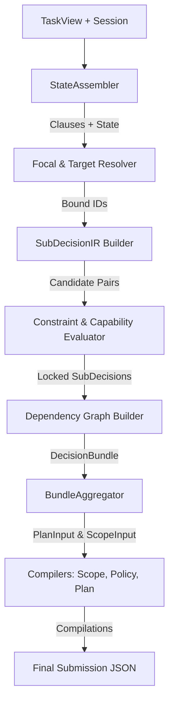

# GParser Refinement & Refactoring Implementation Plan: Candidate-Pair & Active-Constraint Architecture

This plan establishes the refactored architecture of the GParser harness, fully addressing the four logical loopholes and structural contradictions identified.

---

## 1. Core Architectural Shifts (Loophole Fixes)

### ① DecisionBundle & SubDecisionIR Framework
We discard the single-pair selection model in favor of the **DecisionBundle** representation. 
* A prompt is separated into one or more logical clauses.
* Each clause is mapped to a `SubDecisionIR` representing a candidate `(action_candidate, target_candidate)` pair.
* The system evaluates all valid sub-decisions in parallel instead of choosing a single pair prematurely.
* A `DecisionBundle` contains the list of resolved `SubDecisionIR`s and the resolved `dependency_edges`.
* The bundle is finally aggregated by the compiler layer into the single output JSON schema required by the contest submission format.

### ② Deferred Dependency Graph Construction
* **StateAssembler** is strictly restricted to text clause separation and record state collection. It does NOT compute dependency edges.
* The construction of `dependency_edges` is deferred until **after** candidate pairing (Step 4–5).
* Once the `SubDecisionIR` candidates have resolved their actual resource IDs (`focal_id`) and runtime `target` channels, the system runs cross-reference checks (e.g. Read-After-Write) on the resolved IDs to build the final directed dependency edges.

### ③ Compiler Isolation via Pure Projections (`PlanInput`)
* Plan and scope compilers are completely decoupled from raw constraint evaluation and capability status checks.
* The upper layer validates and locks each `SubDecisionIR`.
* An immutable projection `PlanInput` is derived:
  ```python
  @dataclass(frozen=True)
  class PlanInput:
      operation: str              # e.g., "read", "verify", "redact", "update", "dispatch"
      selected_target: str        # e.g., "memory_store", "external_recipient"
      scope_mode: str             # e.g., "status_only", "redacted", "raw"
      modifications: dict[str, Any] # e.g., {"remove_sensitive": True}
  ```
* Compilers consume `PlanInput` to build the ontology-compliant `plan_events` list, avoiding duplicate constraint evaluation logic inside the compilers.

### ④ Redefined Validation Hard Gate
* We scrap the legacy baseline mismatch check. Correcting logical errors (e.g., wrong toggle/amend bindings or payment policy user asks) in the baseline is expected and correct.
* The new **Hard Gate** requires:
  1. **100% pass** on all metamorphic and session lifecycle tests.
  2. **100% match** against the official target answer key in `dev_answers.json` (yielding the maximum valid score of `0.9469` or higher).
* Any differences compared to the legacy baseline outputs are logged and reported as **"Expected Evolution"** items.

---

## 2. Refactored Pipeline Dataflow



### Step 1: Input Clause Parsing (`StateAssembler`)
* Splits the prompt text into sub-clauses (e.g. using separators like "그리고", "다만", "단").
* Collects raw records and checks for latest values sorting chronologically or by turn index.

### Step 2: Focal and Target Binding
* Resolves `focal_id` and candidate target channels for each sub-clause using context markers and session history.

### Step 3: SubDecisionIR Evaluation
* Builds a `SubDecisionIR` for each clause.
* Assesses `CapabilityStatus` against `available_actions` from the task JSON.
* Activates constraints (e.g. consent revoked) specific to each candidate pair.
* Locks the authorized control value (`proceed`, `amend`, `hold`, `ask`).

### Step 4: Dependency Graph Construction
* Inspects resource IDs across locked `SubDecisionIR`s.
* If a subsequent sub-decision reads a resource modified by an earlier sub-decision, draws a directed dependency edge.

### Step 5: Bundle Aggregation & Compilation
* `BundleAggregator` merges the `DecisionBundle` into global representation values.
* If a sub-decision control is `ask`, the overlay state is serialized as a `PENDING_TRANSACTION` inside the session state for next-turn restoration.
* Compilers project individual `SubDecisionIR`s into `PlanInput` and generate final plan events and scopes.

---

## 3. Implementation Checklist & Verification

| Stage | Task | Criteria |
| :--- | :--- | :---: |
| **Pipeline** | Refactor `harness.py` to use `DecisionBundle` flow. | Compiles without errors. |
| **State** | Defer dependency graph building until after ID binding. | Correctly maps Read-After-Write edges. |
| **Compiler** | Decouple compilers using `PlanInput` interface. | No raw constraints checked in compilers. |
| **Session** | Serialize `PENDING_TRANSACTION` for `ask` overlay. | Verified on multi-turn lifecycle. |
| **Validation** | Run `local_score.py` checking against `dev_answers.json`. | Score `>= 0.9469` with 0 mismatches against reference answer key. |
